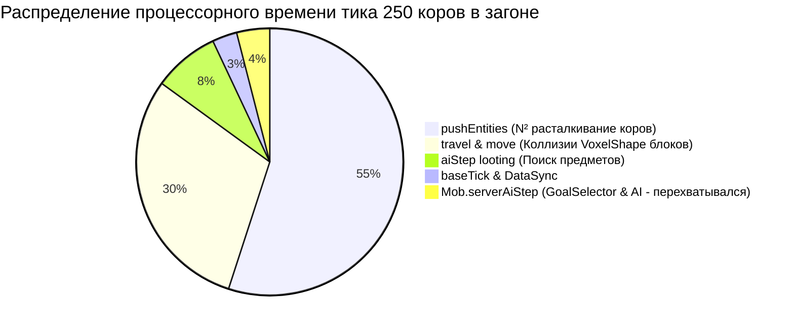
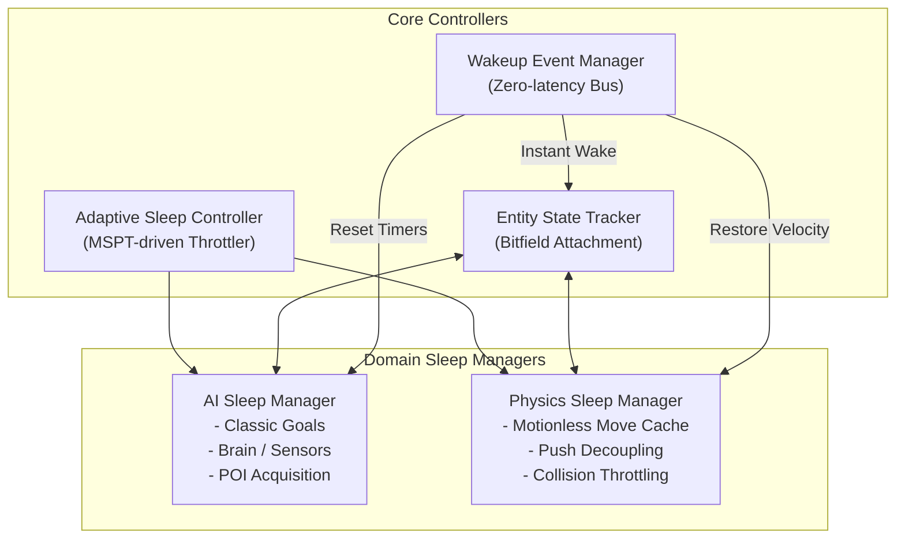

# Phase 7.4 — SleepingEntities Architecture Redesign

**Проект:** KilllTheFrizz  
**Платформа:** Minecraft 1.21.1 / NeoForge 21.1.265 / Java 21  
**Статус:** Исследовательский архитектурный проект (READ-ONLY)  
**Базовый коммит:** `eb2408b`  
**Дата:** 2026-11-02  

---

## 1. Введение и Root-Cause Анализ Phase 7.3

В ходе аудита Phase 7.3 было строго доказано, почему перехват одного лишь `Mob.serverAiStep()` не дал измеримого снижения MSPT на фермах мобов (250 коров):



1. **Локализация узкого места:** `Mob.serverAiStep()` составляет лишь **3–4% процессорного времени** пассивного моба. Остальные **96% времени** тратятся в `LivingEntity.aiStep()` на физику перемещения (`travel()`) и вычисление расталкивания (`pushEntities()`).
2. **Эффект взаимного расталкивания:** Неотменённый `pushEntities()` непрерывно сообщает коровам импульс скорости, из-за чего проверки `VELOCITY` (`> 0.0004`) и `NOT_ON_GROUND` в `IdleChecker` постоянно будят мобов, превращая оптимизацию в циклическую нестабильность.
3. **Villager Brain vs Animal Goals:** В то время как у коров `goalSelector` прост и дешёв, у жителей деревни (`Villager`) именно AI-компонент (`Brain.tick()`, `PoiManager`, поиск кроватей и рабочих мест) является тяжёлым источником нагрузки.

**Решение Phase 7.4:** Разделение монолитного `SleepingEntities` на модульную пятикомпонентную архитектуру с явным разделением сна интеллекта (**AI Sleep**) и сна физических коллизий (**Physics Sleep**).

---

## 2. Архитектура пяти независимых подсистем



---

## 3. Подсистема 1: AI Sleep Manager

Отвечает за раздельное усыпление классического Goal-AI и современного Brain-AI.

### А. Classic Goal-based AI (`Mob.serverAiStep`)
- **Затрагиваемые методы:** `Mob.serverAiStep()` (`Mob.java:764`).
- **Безопасно пропускаемые операции:**
  - `sensing.tick()`
  - `targetSelector.tick()`
  - `goalSelector.tick()`
  - `navigation.tick()` (если путь завершён)
  - `moveControl.tick()`, `lookControl.tick()`, `jumpControl.tick()`.
- **Исключающие условия:** моб имеет цель (`target != null`), горит/получает урон (`hurtTime > 0`), находится в воде/лаве, ведом игроком (пшеница/семена).

### Б. Brain-based AI (`Villager`, `Piglin`, `Warden`)
- **Затрагиваемые методы:**
  - `Villager.customServerAiStep()` (`Villager.java:272`).
  - `Brain.tick(ServerLevel, LivingEntity)` (`Brain.java:402`).
  - `Brain.tickSensors(ServerLevel, E)` (`Brain.java:409`).
  - `AcquirePoi.create()` (`AcquirePoi.java:34`).
- **Безопасно пропускаемые операции для жителей:**
  1. **Сон в кровати (`Activity.REST`):**
     - Если житель лежит в кровати (`entity.isSleeping()`), его сенсоры поиска кровати (`NearestBedSensor`) и вторичных блоков (`SecondaryPoiSensor`) **полностью избыточны**.
     - Безопасный пропуск: вызов `Brain.tickSensors()` сокращается до 1 раза в 100 тиков вместо каждого тика.
  2. **Работа у станка (`Activity.WORK`):**
     - Если житель имеет закреплённый `JOB_SITE` и стоит около него, поиск нового рабочего места через `PoiManager.findAllWithType()` на 48 блоков (вызывающий поиск путей A*) замораживается на время фазы работы.
  3. **Отсутствие игроков и угроз:**
     - При отсутствии игроков в радиусе 32 блоков и отсутствии врагов (`VillagerHostilesSensor` пуст) частота `Brain.tick()` снижается с 20 Гц до 2–4 Гц (каждые 5–10 тиков) со сдвигом по ID.

---

## 4. Подсистема 2: Physics Sleep Manager

Устраняет главную причину лагов скоплений мобов — взаимное расталкивание и холостые коллизии блоков.

> [!IMPORTANT]
> **Принцип сохранения физики:** Физика НЕ отключается полностью. Гравитация, реакции на удары, падения и взаимодействие с игроком сохраняются на 100%.

### А. Оптимизация расталкивания (`pushEntities`)
- **Затрагиваемый метод:** `LivingEntity.pushEntities()` (`LivingEntity.java:2876`).
- **Механика проблемы:** 250 коров в загоне выполняют $250 \times 250 = 62,500$ проверок пересечения AABB каждый тик.
- **Безопасное решение (Mutual Push Damping):**
  - Если обе сталкивающиеся сущности являются спящими (`EST.isPhysicsResting() == true`), они уже находятся в стабильном контакте.
  - Повторное взаимное добавление микровекторов скорости (`entity.push(this)`) блокируется.
  - **Исключение:** Игрок (`Player`) или бодрствующий моб сохраняют 100% силу расталкивания и мгновенно расталкивают спящих коров.

### Б. Пропуск холостого `move()` для неподвижных мобов
- **Затрагиваемый метод:** `LivingEntity.handleRelativeFrictionAndCalculateMovement()` (`LivingEntity.java:2368`).
- **Механика проблемы:** Метод `move(MoverType.SELF, deltaMovement)` вызывается каждый тик, выполняя обход блоков чанка через `level.getBlockCollisions()`, даже когда моб стоит на ровной земле и `deltaMovement == Vec3.ZERO`.
- **Безопасное решение (Stationary Rest):**
  - Если `mob.onGround() == true`, горизонтальная скорость `|deltaMovement| < 1e-6`, ускорение `travelVector == Vec3.ZERO`, и под ногами твёрдый полный блок:
  - Вызов `move(SELF)` пропускается, сохраняя текущую валидную позицию `(x, y, z)`.
  - Вертикальная гравитация не рассчитывается повторно, пока блок под ногами не изменится.

---

## 5. Подсистема 3: Wakeup Event Manager

Централизованная диспетчеризация пробуждения с нулевой задержкой (< 1 тика):

| Событие NeoForge | Источник | Действие WEM |
|---|---|---|
| `LivingDamageEvent.Post` | Любой урон | Мгновенный сброс AI Sleep и Physics Sleep на 100 тиков (`wakeUp(100)`). |
| `ExplosionEvent.Detonate` | Взрывы | Пробуждение затронутых сущностей и AABB `[0, 32]` на 60 тиков. |
| `BlockEvent.NeighborNotifyEvent` | Изменение блоков под мобом | Если разрушен/изменён опорный блок моба — мгновенное пробуждение физики (`Physics Sleep = false`). |
| `EntityMountEvent` | Седло / лодка | Полное исключение из сна. |
| `PlayerMoveEvent` / Proximity | Вход игрока в радиус 16 блоков | Немедленный переход моба в бодрствующее состояние. |
| Наведение приманки (Temptation) | Игрок с пшеницей в руке | Пробуждение навигации и AI на том же тике. |

---

## 6. Подсистема 4: Entity State Tracker

Заменяет медленные коллекции `ConcurrentHashMap<UUID, Long>` в памяти на прямое кэширование в сущности через NeoForge Data Attachment API или `@Unique` поля в `Entity`:

```java
public final class EntityStateTracker {
    public static final byte FLAG_AI_SLEEPING       = 1 << 0;
    public static final byte FLAG_PHYSICS_RESTING   = 1 << 1;
    public static final byte FLAG_BRAIN_THROTTLED   = 1 << 2;
    public static final byte FLAG_FORCE_AWAKE       = 1 << 3;

    // Хранится как 1 байт на сущность — нулевые накладные расходы на GC
    private byte flags;
    private int wakeUntilTick;
}
```

- **Преимущество:** Проверка `(flags & FLAG_AI_SLEEPING) != 0` выполняется за **1 такт CPU** без поиска по хеш-таблицам и без автобоксинга `Long` / `UUID`.

---
## 7. Подсистема 5: Adaptive Sleep Controller

Автоматический регулятор нагрузки по принципу обратной связи (PID-подобный контроль MSPT):

```text
MSPT < 25 ms  -> Tier 1: Легкий сон (только удалённые пассивные мобы, физика 100% активна)
MSPT 25-40 ms -> Tier 2: Стандартный сон (SAFE: Goal AI + взаимный демпфинг pushEntities в загонах)
MSPT 40-48 ms -> Tier 3: Глубокий сон (Brain POI троттлинг жителей + Stationary Move Cache)
MSPT > 48 ms  -> Аварийный режим (Защита тикрейта: пропуск тиков AI для 90% мобов вне поля зрения)
```

При падении нагрузки контроллер плавно восстанавливает полную частоту тиков, исключая визуальные рывки.