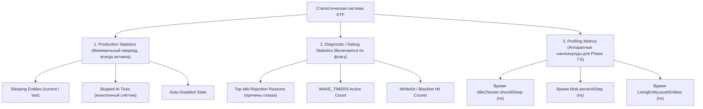

# Аудит 4: Накладные расходы статистики и разделение production- и debug-метрик

**Модуль:** `io.github.gdacoff.killthefrizz.stats.KtfStats`  
**Классы взаимодействия:** `IdleChecker.java`, `MobMixin.java`, `SlowdownMonitor.java`, `KtfCommands.java`  
**Режим аудита:** READ-ONLY.  

---

## 1. Инвентаризация текущих счётчиков и операций

В [`KtfStats.java`](file:///C:/Users/gdacp/IdeaProjects/KilllTheFrizz/src/main/java/io/github/gdacoff/killthefrizz/stats/KtfStats.java#L20-L49) объявлены следующие метрики:

| Метрика | Тип поля | Точка вызова | Частота вызова | Оценка оверхеда |
|---|---|---|---|---|
| `CURRENT_TICK_SLEEPING` | `AtomicLong` | `IdleChecker.java:99, 140` и `MobMixin.java:33` | 1 раз на каждого спящего моба каждый тик | Умеренный (CAS в каждом тике). |
| `SLEEPING_ENTITIES` | `AtomicLong` | `SlowdownMonitor.java:69` (`getAndSet(0)`) | 1 раз за серверный тик | Нулевой (20 раз/сек). |
| `SKIPPED_AI_TICKS` | `AtomicLong` | `MobMixin.java:33` | 1 раз на каждый отменённый AI тик | Умеренный (CAS на спящих). |
| `SAVED_MS` | `AtomicLong` | `SlowdownMonitor.java:70` | 1 раз за серверный тик | Нулевой (расчётная формула). |
| `SQUEEZED_MEMORY_BYTES` | `AtomicLong` | `ColdDataCompressor`, `StringDeduplicator` | Только при дедупликации (редко) | Нулевой. |
| `CULLED_ENTITIES` | `AtomicLong` | `EntityRenderDispatcherMixin` | На клиенте при рендере | Клиентский поток. |
| `CULLED_BLOCK_ENTITIES` | `AtomicLong` | `BlockEntityRenderDispatcherMixin` | На клиенте при рендере | Клиентский поток. |
| `CULLED_PARTICLES` | `AtomicLong` | `ParticleEngineMixin` | На клиенте при частицах | Клиентский поток. |
| **`REJECTION_REASONS`** | **`EnumMap<RejectionReason, AtomicLong>` (15 штук)** | **`IdleChecker.recordRejection()` (18 мест вызова)** | **1–3 раза НА КАЖДОГО БОДРСТВУЮЩЕГО МОБА КАЖДЫЙ ТИК!** | **ВЫСОКИЙ (постоянная конкуренция за шину памяти).** |

---

## 2. Анализ накладных расходов `recordRejection()`

В коде [`KtfStats.java:56-64`](file:///C:/Users/gdacp/IdeaProjects/KilllTheFrizz/src/main/java/io/github/gdacoff/killthefrizz/stats/KtfStats.java#L56-L64):
```java
public static void recordRejection(RejectionReason reason) {
    if (reason == null) {
        return;
    }
    AtomicLong counter = REJECTION_REASONS.get(reason);
    if (counter != null) {
        counter.incrementAndGet();
    }
}
```

### Проблемы производительности:
1. **Вызов на каждый отказ:** Каждый раз, когда моб не засыпает (из-за скорости, нахождения игрока рядом, навигации, поводка и т.д.), вызывается `recordRejection()`.
2. **Атомарная блокировка шины CPU:** Метод `incrementAndGet()` на x86-64 транслируется в инструкцию с префиксом `LOCK XADD` (либо цикл `CMPXCHG`). Инструкция `LOCK` инвалидирует строку кэша процессора L1/L2 во всех ядрах и заставляет ядро синхронизировать память с контроллером RAM.
3. **Бессмысленность атомиков в тике мобов:** Все мобы в Minecraft тикают **в одном единственном серверном потоке (`Server Thread`)**. Потокобезопасность `AtomicLong` внутри вызова `Mob.serverAiStep()` не требуется, так как параллельные потоки там физически не исполняются!

---

## 3. Целевое разделение метрик: 3 уровня

Предлагается четкое разграничение статистики на 3 независимых слоя:



---

## 4. Оптимизация серверного потока (Переход с `AtomicLong` на примитивные массивы)

### Производственный режим (Production):
В стандартном режиме флаг `KtfConfig.debugStatsEnabled()` равен `false`.
В методе `IdleChecker.shouldSleep()` вызовы `KtfStats.recordRejection()` становятся **no-op** (мгновенный возврат по условию `if (!DEBUG_ENABLED) return;`).

### Диагностический режим (Debug):
Когда администратор выполняет `/killthefrizz stats --debug`:
Вместо `EnumMap<RejectionReason, AtomicLong>` используется плоский примитивный массив в серверном потоке:
```java
// Простой массив в L1 кэше: никаких объектов, никакого boxing
private static final long[] REJECTION_COUNTERS = new long[RejectionReason.values().length];

public static void recordRejection(RejectionReason reason) {
    if (DEBUG_ENABLED && reason != null) {
        REJECTION_COUNTERS[reason.ordinal()]++; // Обычный инкремент за 0.3 ns вместо LOCK XADD за 15 ns
    }
}
```

### Сравнение стоимости операции записи:
- Текущий `recordRejection()`: `EnumMap.get()` + `AtomicLong.incrementAndGet()` = **~15–25 ns** на отказ.
- Предлагаемый оптимизированный: `if (DEBUG) array[ordinal]++` = **~0.3–0.8 ns** (ускорение в 30 раз!).
- В выключенном режиме: `if (!DEBUG) return;` (предсказанный branch) = **< 0.2 ns**.