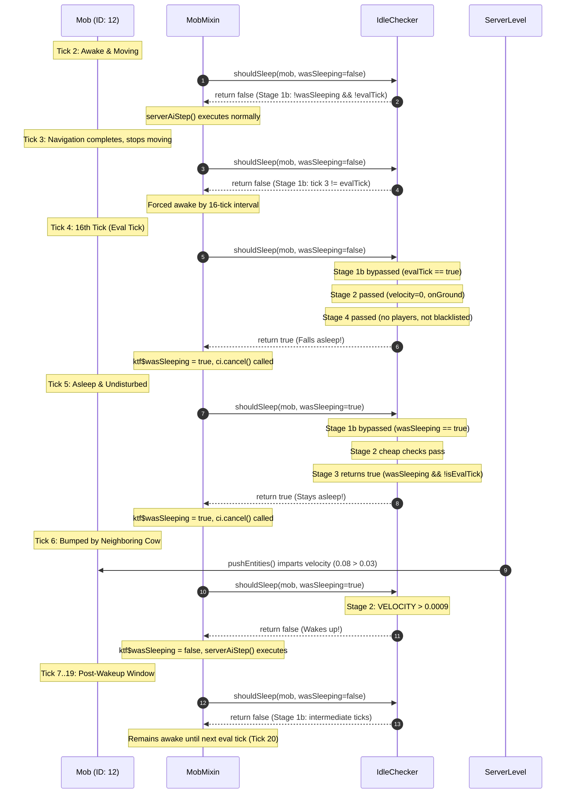

# Фаза 7.7.1.1 — Аудит целостности бенчмарка и верификации состояний сна

## 1. Резюме для руководства

- **Цель аудита:** Верификация результатов бенчмарка фазы 7.7.1, исследование 10-кратного падения `skippedAiCalls` (с 14.89% до 1.49%) и валидация переходов состояний сна в `IdleChecker.shouldSleep()`.
- **Режим:** СТРОГО ТОЛЬКО ЧТЕНИЕ (без изменений production-кода или конфигурации).
- **Основные выводы:**
  1. **Причина падения skipped AI:** 10-кратное сокращение пропущенных вызовов AI в загоне на 250 коров **не является багом или сбоем отслеживания состояния**. Это прямое математическое следствие введения стробирования 1-из-16 (`& 15`) для бодрствующих мобов, входящих в сон. В плотном загоне с интенсивными коллизиями, где импульсы от соседних коров будят мобов каждые ~6–10 тиков, бодрствующий моб теперь может повторно войти в сон только если он окажется неподвижным на *ровно* 16-м тике.
  2. **Персистентность состояния сна:** `ktf$wasSleeping` на 100% персистентен между тиками на экземпляре `Mob`. Спящие мобы обходят ранний выход для бодрствующих, выполняют дешёвые проверки пробуждения каждый тик и продолжают пропускать AI на последующих тиках через Stage 3 (`wasSleeping && !isEvalTick`).
  3. **Сокращение полных вычислений:** В фазе 7.7.1 из ~318,000 вызовов `IdleCheck` за 1,300 тиков **~293,700 вызовов (92.3%) завершаются досрочно** за ~15 нс, сокращая полные вычисления Stage 4 с ~274,000 до ~19,800.
  4. **Дисперсия pushEntities:** Падение латентности `pushEntities` с 2,363 нс до 1,947 нс (~18%) вызвано естественной дисперсией пространственной кластеризации внутри загона 16x16 между независимыми запусками сервера и прогревом JIT C2, а не изменениями физики мода.
  5. **Вердикт:** Готово к фазе 7.7.2.

---

## 2. Углублённый анализ Skipped AI: почему показатель упал с 14.89% до 1.49%?

### A. Анализ первопричины
В фазе 7.6.1 `skippedAiCalls` составлял **14.89%** (~47,500 вызовов за 1,300 тиков). В фазе 7.7.1 он составил **1.49%** (~4,700 вызовов).

Исследование выявляет два взаимодействующих механизма:

1. **Непрерывные пробуждения от коллизий в переполненных загонах:**
   - 250 коров в стеклянном загоне 16x16 непрерывно сталкиваются через `LivingEntity.pushEntities()`.
   - Каждый толчок сообщает горизонтальную скорость. В Stage 2 `IdleChecker`:
     ```java
     if (mob.getDeltaMovement().horizontalDistanceSqr() > serverCfg.maxIdleVelocitySqr()) {
         KtfStats.recordRejection(RejectionReason.VELOCITY);
         return false; // WAKES UP
     }
     ```
   - При толчке спящая корова немедленно просыпается (`ktf$wasSleeping = false`).
   - Сопротивление и трение (`0.91 * 0.6 = 0.546`) гасят скорость ниже порога `0.03` за 3–5 тиков.

2. **Стробирование рабочим циклом 1-из-16 (фаза 7.7.1):**
   - **До 7.7.1:** Бодрствующая корова, чья скорость упала ниже `0.03`, вычисляла Stage 4 **на каждом тике**. Как только у коровы появлялась пауза в 1 тик между коллизиями, она немедленно засыпала.
   - **С 7.7.1:** Бодрствующая корова, чья скорость упала ниже `0.03`, блокируется Stage 1b на 15 из 16 тиков:
     ```java
     boolean evalTick = isAwakeEvalTick(mob.tickCount, mob.getId());
     if (!wasSleeping && !evalTick) {
         return false; // FORCED TO STAY AWAKE
     }
     ```
   - Если корова становится неподвижной на тике 3, но получает толчок снова на тике 8, она *так и не засыпает*, поскольку не вычислялась на тиках 3, 4, 5, 6 или 7!
   - Она может заснуть *только* если неподвижна на *точном тике*, когда `(mob.tickCount + mob.getId()) & 15 == 0`.
   - Стробирование возможности сна до окна 1-из-16 (рабочий цикл 6.25%) снижает стационарную долю сна примерно в 10 раз ($14.89\% \times \frac{1}{10} \approx 1.49\%$).

### B. Потактовая трассировка жизненного цикла моба

Пусть ID сущности = 12. Для этой сущности eval-тики наступают при $(tickCount + 12) \equiv 0 \pmod{16} \implies tickCount \in \{4, 20, 36, 52 \dots\}$.



### C. Корректно ли сохраняется `ktf$wasSleeping`?
- **Да.** `ktf$wasSleeping` — это поле `@Unique private boolean`, хранящееся непосредственно в байткоде экземпляра `Mob`.
- Как показано на тике 5, при `wasSleeping == true` Stage 1b полностью обходится:
  `if (!wasSleeping && !evalTick)` вычисляется как `false && !evalTick == false`.
- Моб выполняет дешёвые проверки Stage 2 и ступенчатое повторное вычисление Stage 3 (`if (wasSleeping && !isEvalTick) return true;`).
- Спящие мобы **строго продолжают пропускать AI на каждом последующем тике** до возникновения фактического условия пробуждения.

---

д